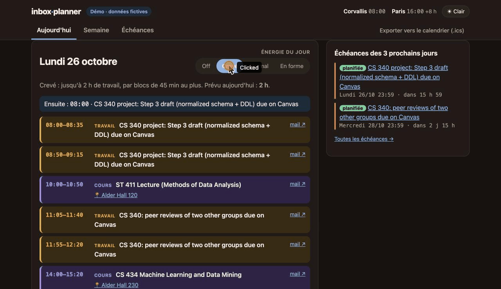
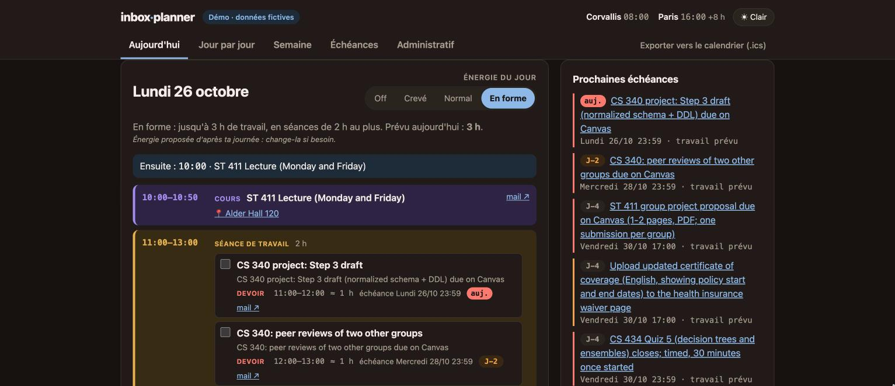
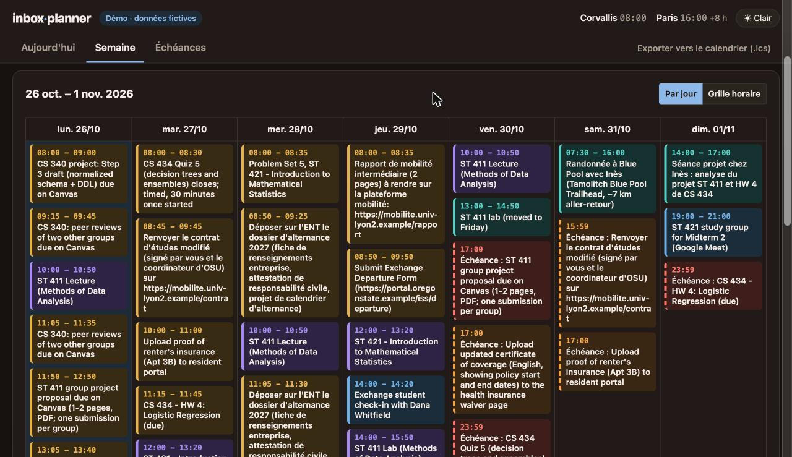
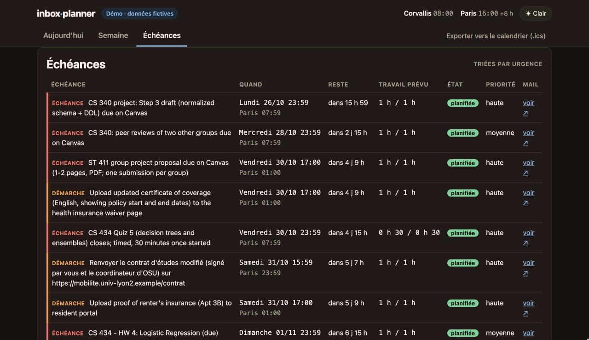
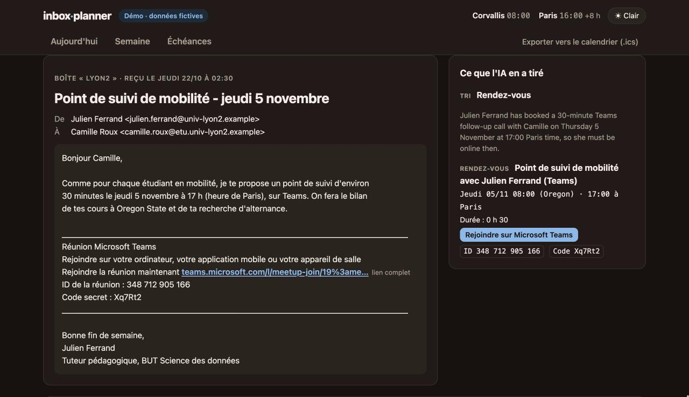
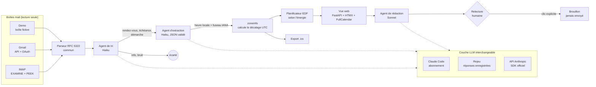

# inbox-planner

**Un planner piloté par l'IA qui lit mes boîtes mail (en lecture seule) et en tire mon emploi du temps, mes échéances et des brouillons de réponse. Il répartit ensuite le travail selon mon énergie du jour.**

[](https://github.com/mbolmier/inbox-planner/actions/workflows/ci.yml)




*Démo sur une boîte mail entièrement fictive. Aucun compte n'est nécessaire.*

> **English summary.** inbox-planner reads several mailboxes (read-only), uses Claude to triage each e-mail and extract appointments and deadlines as validated JSON, then plans the week with a deterministic, energy-aware algorithm. Two design rules: **the LLM reads, the code computes** (time zones and daylight-saving changes are computed with `zoneinfo`, never by the model), and **nothing is ever sent** (replies are proposed, reviewed by a human, then saved as drafts). On 40 hand-labelled fictional e-mails, extraction is 31/31 with exact dates and time zones for Haiku, Sonnet and Opus, so the default chain uses Haiku (about $0.03 per 40 e-mails). Everything ran on a Claude subscription through Claude Code (a 20 €/month Pro plan is plenty; API-equivalent cost: about $0.03 for a week of 40 e-mails). Demo: `uv run inbox-planner web`, no account and no API key.

---

## L'histoire

Pendant mon échange universitaire (Université Lumière Lyon 2 → Oregon State University), je jonglais avec trois boîtes mail : l'Outlook de Lyon 2, l'Outlook d'Oregon State et mon Gmail perso. S'y ajoutaient plusieurs plateformes de cours et des démarches administratives dans deux pays, avec neuf heures de décalage.

Je me suis construit un planner piloté par l'IA. Il lisait mes mails, en tirait mes cours, mes échéances et mes rendez-vous, rédigeait des brouillons de réponse, et répartissait le travail selon mon énergie du jour. **Ce dépôt en est la version propre, générique et publiable.** Tout ce qui est réel a été remplacé par des données fictives ([ce qui est réel ou inventé](docs/donnees-demo.md)).

## Ce que ça fait

| | |
|---|---|
| **Connecteurs mail, lecture seule** | **Demo** (boîte fictive, par défaut). **Gmail** (API officielle, OAuth, lecture seule par défaut). **IMAP** (`EXAMINE` + `BODY.PEEK`, rien n'est modifié ni marqué comme lu). Tous passent par le même parseur. |
| **Agent de tri** | Le mail est-il utile, et de quel type : rendez-vous, échéance, démarche, info ou bruit ? |
| **Agent d'extraction** | Il renvoie du JSON validé par un schéma : titre, date et heure locales avec fuseau, durée, lieu, lien de visio avec ID et code, priorité, récurrence. |
| **Planification** | Un algorithme déterministe (échéance la plus proche d'abord) répartit le travail à l'avance sur les jours qui précèdent chaque échéance, en séances à des heures normales (une par jour, deux si un cours coupe la journée), selon l'énergie du jour : Off, Crevé (1 h), Normal (2 h), En forme (3 h). L'énergie est proposée d'après la semaine et les cours, et se change d'un clic. |
| **Agent de rédaction** | Il propose une réponse (confirmer, décliner, poser une question). Elle est relue, modifiée si besoin, puis enregistrée comme brouillon. **Jamais envoyée.** |
| **Lieux cliquables** | Un rendez-vous physique ouvre Google Maps, un rendez-vous en ligne ouvre Teams, Zoom ou Meet (lien déballé des Safe Links d'Outlook). |
| **Vue web** | Aujourd'hui avec les prochaines échéances en compte à rebours (auj., demain, J-3), le jour par jour avec la charge de chaque jour, la semaine (FullCalendar, détail au clic), les échéances triées par urgence, l'administratif groupé par organisme. Chaque tâche se coche quand elle est faite. Thème sombre ou clair. Chaque élément est relié à son mail d'origine, dont les liens sont raccourcis et cliquables. |
| **Export** | Un fichier `.ics` pour Apple Calendar et Google Agenda : fuseaux conservés, cours récurrents, rappel la veille des échéances. |

| Aujourd'hui | Semaine |
|---|---|
|  |  |
| **Échéances** | **Un mail et ce que l'IA en a tiré** |
|  |  |

## Les chiffres

Évaluation sur **40 mails fictifs annotés** ([guide d'annotation](docs/guide-annotation.md)), **31 éléments attendus**. Le jeu contient des pièges voulus : la semaine où l'écart Paris – Oregon n'est que de 8 h, des échéances juste après le changement d'heure, une sortie le samedi et une séance de travail le dimanche, de part et d'autre du passage à l'heure d'hiver en Oregon, un cours qui n'a pas la même heure le mercredi, des dates relatives (« this Monday »), un lien Teams emballé par Outlook Safe Links, un mail en HTML seul, une séance déplacée, des dates dans des promotions et un hameçonnage.

| Tri | Exactitude | Rappel « utile » | Coût estimé (40 mails) |
|---|---|---|---|
| Haiku 5.5 | 95 % | 100 % | 0,016 $ |
| Sonnet 5.5 | 90 % | 100 % | 0,250 $ |
| Opus 5.5 | 98 % | 100 % | 0,543 $ |

| Extraction | Dates exactes, fuseau compris | Liens visio | ID + code | Récurrences | Coût estimé (40 mails) |
|---|---|---|---|---|---|
| Haiku 5.5 | **31/31** | 4/4 | 4/4 | 6/6 | 0,023 $ |
| Sonnet 5.5 | **31/31** | 4/4 | 4/4 | 6/6 | 0,371 $ |
| Opus 5.5 | **31/31** | 4/4 | 4/4 | 6/6 | 0,782 $ |

**Chaîne par défaut : Haiku → Haiku**, avec 100 % de précision et de rappel pour **0,034 $** les 40 mails. Rapport complet : [docs/evaluation.md](docs/evaluation.md). La CI le régénère à chaque PR et échoue s'il n'est plus à jour.

**Ce que ces chiffres disent, et ne disent pas :**
- **L'extraction ne départage pas les modèles :** 100 % pour les trois. Avec 31 éléments, un 100 % reste compatible avec environ 10 % d'erreur réelle (règle de trois). Il faudrait un jeu plus difficile.
- **Un modèle « plus fort » n'est pas meilleur sur tout.** Sonnet classe en « info » les mails d'emploi du temps reçus un mois plus tôt, ce qui retirerait les cours du calendrier ([D49](docs/decisions.md#d49-le-tri-dépend-du--maintenant---constat-sur-sonnet)).
- **Les erreurs restantes viennent de ma spécification**, pas des modèles. Je n'ai volontairement pas retouché les prompts sur le jeu de test ([D34](docs/decisions.md#d34-pas-de-retouche-des-prompts-sur-le-jeu-de-test)).
- **Coûts estimés au tarif public de l'API.** En réalité, tout a tourné sur un abonnement Claude, sans rien payer en plus (voir ci-dessous).

### Combien ça coûte

Tout a tourné via Claude Code avec un abonnement Claude : aucune clé API, aucune dépense en plus de l'abonnement. **Un abonnement Claude Pro à 20 €/mois suffit largement** pour l'usage normal. Une semaine type de 40 mails représente environ 70 appels au modèle Haiku. J'ai moi-même un abonnement Max, qui m'a servi pour la comparaison complète des trois modèles, dont Opus, plus gourmand.

Pour comparer, voici ce que ça coûterait via l'API Anthropic, au tarif public :

| Usage | Tokens | Coût API estimé |
|---|---|---|
| Une semaine type : les 40 mails de la démo, chaîne Haiku → Haiku | ≈ 223 000 | ≈ 0,03 $ |
| Ma vraie boîte Gmail : 100 mails sur 14 jours, analysés deux fois | ≈ 1,3 million | ≈ 0,15 $ |
| Tout le projet : évaluation des 3 modèles enregistrée deux fois, essais réels, brouillons | — | ≈ 4 $ |

## Démarrer

```bash
uv sync
uv run inbox-planner web          # http://127.0.0.1:8000, démo fictive, sans compte ni clé
uv run inbox-planner plan --energy creve,normal,forme,normal,normal,off,normal
uv run inbox-planner eval         # rejoue l'évaluation depuis les réponses enregistrées
```

Avec Docker (la démo, sous un utilisateur non-root, accessible depuis cette machine seulement) :

```bash
docker build -t inbox-planner .
docker run --rm -p 127.0.0.1:8000:8000 inbox-planner
```

Brancher sa vraie boîte Gmail : voir [docs/connecteurs.md](docs/connecteurs.md).

## Architecture



## Les choix que je défends

Les 71 décisions sont expliquées dans [docs/decisions.md](docs/decisions.md), chacune avec la décision, les alternatives et le pourquoi. Les principales :

- **Le LLM lit, le code calcule** ([D25](docs/decisions.md#d25-le-llm-lit-le-code-calcule)). Le modèle renvoie une heure *locale* et un nom de fuseau ; `zoneinfo` calcule le décalage. Un LLM peut se tromper sur un changement d'heure, `zoneinfo` jamais. Exemple visible dans la démo : pour l'entretien du 3 novembre (mail m21), la justification écrite par le modèle dit « 17 h 30 à Paris, soit 9 h 30 à Los Angeles », ce qui est faux. L'heure affichée, calculée par `zoneinfo`, est la bonne : 8 h 30.
- **La planification est un algorithme, pas un LLM** ([D36](docs/decisions.md#d36-la-planification-est-un-algorithme-pas-un-llm)). Elle a des contraintes dures (aucun chevauchement, capacité du jour, échéances) et doit être déterministe, testable et explicable. 300 semaines aléatoires vérifient 8 règles à chaque commit (tests par propriétés avec `hypothesis`).
- **Un seul schéma pour l'extraction et les annotations** ([D20](docs/decisions.md#d20-un-seul-schéma-pour-lextraction-et-pour-les-annotations)), et un faux modèle « parfait » qui doit obtenir 100 % ([D32](docs/decisions.md#d32-un-faux-modèle--parfait--doit-obtenir-100-)), pour s'assurer que la mesure ne déforme rien.
- **Une heure de référence explicite dans chaque prompt** ([D42](docs/decisions.md#d42-une-heure-de-référence-explicite-dans-chaque-prompt)). Bug trouvé en regardant l'interface : le modèle connaissait la vraie date du jour et jugeait les mails de la démo « déjà passés ».
- **Validation humaine avant toute écriture, et aucun envoi possible** ([D51](docs/decisions.md#d51-deux-niveaux-de-consentement-et-aucun-envoi-possible-dans-le-code), [D52](docs/decisions.md#d52-validation-humaine-en-deux-temps-avant-toute-écriture)). Gmail n'a pas d'autorisation « brouillons sans envoi » : la garantie est dans le code, et un test fait échouer la CI si un appel d'envoi apparaît.
- **Zéro dépense** ([D12](docs/decisions.md#d12-llm-sans-dépense-au-delà-de-labonnement-claude)). Les réponses des modèles sont enregistrées une fois via Claude Code, puis rejouées. La démo, les tests et la CI n'appellent aucun modèle.

## Confidentialité et sécurité

- **Aucune donnée réelle dans le dépôt.** Un test fait échouer la CI si une adresse n'est pas en `.example` ou si un lien sort d'une liste autorisée, y compris dans les 263 réponses de modèle enregistrées ([D18](docs/decisions.md#d18-garde-fou-de-confidentialité-testé-en-ci)).
- **Secrets hors du dépôt.** Les jetons OAuth, le fichier client et le cache des réponses sur de vrais mails vivent dans `~/.inbox-planner/`, en droits 600. Le scan gitleaks tourne avant chaque commit, avant chaque push et en CI.
- **Lecture seule par défaut** (`gmail.readonly`). Les brouillons demandent un second consentement, à part.
- **Les mails sont des données non fiables.** Leur corps est affiché en texte échappé, jamais en HTML. Les agents n'ont aucun outil et leur sortie est validée par un schéma ([D58](docs/decisions.md#d58-le-contenu-des-mails-est-une-donnée-non-fiable)). L'interface a une CSP stricte, ses scripts CDN sont épinglés avec SRI, et elle n'écoute qu'en local.

## Limites

- **Le jeu d'évaluation est petit et trop facile** pour départager les modèles en extraction. Les annotations sont de moi, avec un assistant IA pour la première rédaction.
- **Outlook universitaire (Microsoft Graph) n'est pas branché :** les universités exigent en général l'accord de leur DSI pour une application tierce ([D55](docs/decisions.md#d55-microsoft-graph-outlook-de-lyon-2-et-dosu--pas-fait-et-pourquoi)). L'export vers Apple Rappels n'est pas fait non plus.
- **Une séance déplacée ou annulée ne retire pas la séance récurrente d'origine.** Le conflit est signalé, pas résolu.
- **Le travail est étalé, donc la marge est plus courte** : une tâche peut tomber la veille de son échéance quand les jours d'avant sont plus chargés ([D64](docs/decisions.md)).
- **Le client API Anthropic n'est jamais exécuté ici.** Il est vérifié contre la signature du SDK et testé avec un faux SDK.
- **Les longues newsletters coûtent cher au tri** (environ 6 000 tokens par mail sur une vraie boîte). Tronquer serait une piste, à mesurer d'abord.

## Structure

```
src/inbox_planner/
  connectors/   Demo, Gmail, IMAP, contrat MailConnector
  mail/         modèle Message, parseur RFC 5322, HTML → texte, réponses en fil
  agents/       tri, extraction, rédaction (sorties structurées)
  llm/          Claude Code, cache de rejeu, API Anthropic
  planning/     calendrier, énergie, planificateur EDF
  evaluation/   annotations, métriques, rapport
  web/          FastAPI, gabarits Jinja + HTMX, FullCalendar
  export/       .ics
  demo_data/    boîte fictive, annotations, réponses enregistrées
docs/           décisions, évaluation, guide d'annotation, connecteurs, données de démo
tests/          193 tests, dont propriétés (hypothesis) et garde-fous de confidentialité
```

**Stack :** Python 3.12, uv, ruff, pytest, hypothesis, Pydantic, FastAPI, Jinja2, HTMX, FullCalendar, SQLModel/SQLite, icalendar, Claude (Haiku, Sonnet, Opus 5.5), GitHub Actions, Docker, gitleaks.

## Licence

[MIT](LICENSE) © Martin Bolmier
